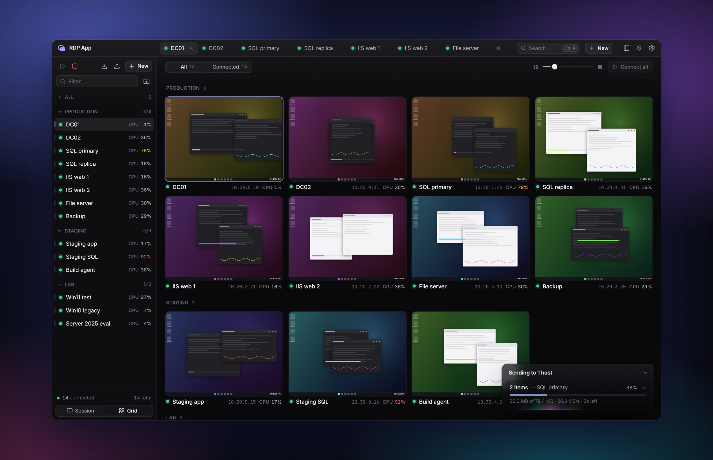

<div align="center">


# RDP App

**A fast, minimal Remote Desktop client for Windows, built to run 50–100+ sessions at once.**

[](https://github.com/JeromeJaJa/rdp-app/actions/workflows/ci.yml)
[](https://github.com/JeromeJaJa/rdp-app/releases/latest)
[](LICENSE)


[Download](#download) · [Features](#features) · [Getting started](#getting-started) · [How it works](docs/ARCHITECTURE.md)

<br>



</div>

<br>

Most Remote Desktop clients are built around one session at a time. RDP App is built around a whole fleet of them.
Every session runs on its own thread, the ones you aren't looking at are paused on the server so they cost almost
nothing, and a live grid shows them all at once. Everything else stays out of the way: one window, dark glass, a
command palette, and keyboard shortcuts for all of it.

## Features

**Built for many sessions**

- Run **50–100+ sessions** side by side. Hidden sessions stop sending frames until you look at them again.
- A **live grid** of every session: watch them all, click one to open it, drag to reorder.
- **Groups** that connect, disconnect, import, export or receive files as a whole.
- **Bulk add** from a pasted list (`host:user:pass`, `host:port:user:pass`, `DOMAIN\user`, `user@domain`,
  `[ipv6]:port:…`), or **replace** a group's list in one go; connections that stay keep their live sessions.

**Sharp, fast graphics**

- H.264 through the graphics pipeline, including **AVC444** (full 4:4:4 color, so small colored text stays crisp).
- Decoded on the **GPU** (Media Foundation / DXVA), or in software. Also RemoteFX, ClearCodec and Planar.
- Only the regions that changed are converted and copied to the screen, with no per-frame messages in between.

**Tabs and windows your way**

- Tabs on top or on the left, drag to reorder, `Ctrl+K` to jump anywhere.
- **Tear tabs off** into windows of their own, Chrome-style, and drag them between windows. Sessions stay connected
  and resize to fit the window they're in.
- A session toolbar on the top edge sends Win, Ctrl+Alt+Del, Alt+Tab and friends, mutes, reconnects or goes
  fullscreen.

**Everything you expect from RDP**

- Clipboard both ways: text, images, and files (copy in Explorer on one side, paste on the other).
- Audio playback and microphone, drive, printer and smart card redirection, dynamic resolution, auto-reconnect.
- Server certificates pinned on first use, with a warning if one ever changes.

**The companion** (experimental, off by default): a small helper inside each remote session that adds what plain RDP
can't do. [More below](#the-companion).

- **Fast copies**: copy and paste files or text between here and there, streamed and compressed.
- **Drag and drop files** between this PC and a session, both ways, like a normal Windows drag.
- **Send files** to one host, a group, or a selection: drop them on a tab, a group or a grid tile.
- **Host stats** on every row and tile: CPU, memory, network or disk, with recent history on hover.
- **Program controls**: launch, restart or close a program across a selection of hosts.

**Scriptable**

- A **local REST API** (with interactive docs and an `llms.txt`) lets scripts and AI agents do everything you can
  do in the window. [More below](#automation).

## Download

Grab `RDP-App_<version>_x64-setup.exe` from the latest [**Release**](https://github.com/JeromeJaJa/rdp-app/releases/latest)
and run it. It runs on Windows 10 and 11 (x64), installs per user (no admin needed) to
`%LOCALAPPDATA%\RDP App`, and installs WebView2 if it's missing.

After that it **updates itself**: it checks for new versions every few hours and downloads them in the background,
and an **Update** button appears in the title bar when one is ready. Restarting into it is always your call, since it
disconnects your sessions. **Settings → About** shows your version, what's new, and lets you check by hand or turn
automatic updates off.

The builds aren't code-signed yet, so SmartScreen may warn the first time: choose **More info → Run anyway**.
`SHA256SUMS.txt` on each release lists the installer's checksum.

## Getting started

1. **Add connections.** **+ New** (or `Ctrl+N`) adds one; `Ctrl+Shift+N` pastes a whole list.
2. **Connect.** Double-click a connection, or select it and press `Enter`. Right-click a group for **Connect all**.
   Nothing connects until you ask.
3. **See them all.** `Ctrl+G` switches to the grid.

<details>
<summary><b>All shortcuts</b></summary>
<br>

| Action | How |
| --- | --- |
| Jump to a connection or run a command | `Ctrl+K`, or **Search** in the title bar |
| Add one / many | `Ctrl+N` / `Ctrl+Shift+N`, or **+ New** |
| Connect | Double-click, or select and press `Enter` |
| Pick several connections | `Ctrl`+click / `Shift`+click in the sidebar, then right-click one of them |
| Group actions (connect, replace list, import / export, rename) | Right-click the group header |
| Grid view | `Ctrl+G`, or the grid toggle |
| Next / previous tab | `Ctrl+Tab` / `Ctrl+Shift+Tab`, `Ctrl+1…9`, or `Shift`+scroll over the top tabs |
| Open a tab in its own window | Drag it out of the tab strip, or right-click → **Open in new window** |
| Move a tab back to the main window | Its ×, `Ctrl+W`, or close its window |
| Session toolbar | Rest the pointer on the top edge of a session |
| Send Win, Win+R, Alt+Tab, Task Manager… | Session toolbar → keyboard button |
| Release the keyboard from a session | Click outside it, or `Ctrl+Alt+Home` |

While a session has focus, every key goes to it, and the app's shortcuts come back when it loses focus. Windows keeps
a few combinations for itself (Win, Alt+Tab, Ctrl+Alt+Del): send those from the session toolbar.

</details>

Your library lives in `%APPDATA%\com.jeromejaja.rdpapp\library.json`, with pinned certificates in `certs.json` next
to it. **Import / export** (from the sidebar, or per group) moves it between machines as JSON or as a plain list.

## The companion

Some things plain RDP can't do well. Uploads are the clearest case: Windows' RDP listener keeps its receive window
at 64 KiB, so a copy to a distant host crawls whatever your bandwidth. The companion is a small program that runs
inside the remote session and opens a channel back to the app, and that's what makes fast copies, drag and drop,
sends, host stats and program controls possible.

- **Off by default.** Turn it on in Settings, for all connections, a group, or a single one. The app installs it
  over WinRM where the host allows that, and keeps it up to date.
- **A direct link when it can.** File transfers and the companion's messages take a direct, encrypted QUIC link
  beside the session, set up the way Tailscale does it: both sides reach out and meet in the middle (with a public
  STUN server's help to find their addresses), so **no port is opened** anywhere. Each side accepts only the other's
  certificate, swapped over the RDP session. If the link can't be made, or drops, everything carries on over RDP.
- **It stays in its lane.** It runs as the signed-in user, drags only ever copy (never move), and program controls
  only touch programs in that user's session.

The companion is newer than the rest of the app and has seen fewer setups.
[docs/ARCHITECTURE.md](docs/ARCHITECTURE.md#the-companion) has the details.

## Automation

The app runs a REST API for scripts and AI agents. It listens on `127.0.0.1:47123` only, and every request needs the
token shown in **Settings → Automation**:

```sh
curl -H "Authorization: Bearer <token>" http://127.0.0.1:47123/api/v1/state
```

It covers groups and connections (bulk add and group replace included), sessions (connect, wait, disconnect,
reconnect), screenshots, keyboard, mouse and text input, certificates, settings, import / export, and a live stream
of status changes.

- `http://127.0.0.1:47123/docs`: an interactive reference
- `http://127.0.0.1:47123/llms.txt`: the same reference as plain text, to hand to an agent
- `http://127.0.0.1:47123/openapi.json`: the OpenAPI 3 description

## Privacy and security

- **Passwords are encrypted with Windows DPAPI**, tied to your Windows account, and never reach the interface.
- **No accounts, no cloud, no telemetry.** The app talks to your hosts, and when the companion sets up a direct
  link, to a public STUN server to learn its own address.
- **The REST API is loopback-only** and needs a token.
- **No system-wide keyboard hook and no injected input.** Special keys go through the session, and keystrokes are
  never logged.
- **Exports include passwords in plain text**, by design, so a backup restores everything. Treat an export file like
  the passwords themselves.

## Building from source

You'll need Rust (MSVC toolchain), [Bun](https://bun.sh), the Visual Studio C++ build tools, and
[NASM](https://www.nasm.us) on your `PATH` (without it the H.264 decoder quietly builds without its assembly and
decodes much slower).

```sh
bun install
bun run tauri dev      # the full app
bun run dev            # just the UI, in a browser, with a mock backend and fake sessions
bun run build:release  # a release build, with the installer, in target/release/bundle/nsis/
```

`cargo test --workspace` runs the Rust tests. `crates/rdp-testserver` runs local RDP servers with animated content,
so you can load-test without real hosts; [docs/ARCHITECTURE.md](docs/ARCHITECTURE.md#testing-without-real-hosts)
shows how.

## Documentation

- [**How it works**](docs/ARCHITECTURE.md): the code layout, how frames reach the screen, the companion and its
  direct link, testing, releases, and current limitations.
- [**Contributing rules**](AGENTS.md): the invariants, performance rules and Windows gotchas to know before changing
  the code, for people and coding agents alike.
- [**Changelog**](CHANGELOG.md): what changed in each release.

## Status

RDP App is young (0.x), and its core (sessions, graphics, clipboard, tabs and windows) is tested against real
Windows hosts. A few parts are built but not yet tested against real hardware: audio, microphone, drive / printer /
smart card redirection, RD Gateway, and AVC444 from a Windows server. The companion works on the hosts it has met,
but those are few so far. See [current limitations](docs/ARCHITECTURE.md#current-limitations).

Issues and pull requests are welcome. Please read [AGENTS.md](AGENTS.md) first: performance is treated as a
correctness requirement here.

## Acknowledgements

Built on [IronRDP](https://github.com/Devolutions/IronRDP) and [Tauri](https://tauri.app), with
[quinn](https://github.com/quinn-rs/quinn), [OpenH264](https://github.com/cisco/openh264), React and many other
open-source projects.

## License

[MIT](LICENSE)
