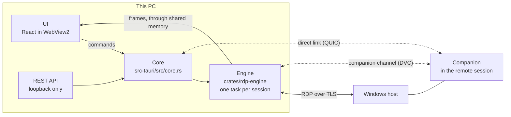

# How RDP App works

This is the tour of the code: what the pieces are, how a frame gets from a server to your screen, and how the
companion and its direct link work. The [README](../README.md) covers what the app does and how to install it.
[AGENTS.md](../AGENTS.md) holds the rules for changing the code: invariants, performance rules and Windows gotchas.

- [The big picture](#the-big-picture)
- [Code layout](#code-layout)
- [Sessions](#sessions)
- [How frames reach the screen](#how-frames-reach-the-screen)
- [The UI](#the-ui)
- [Storage, settings and the REST API](#storage-settings-and-the-rest-api)
- [The companion](#the-companion)
- [Testing without real hosts](#testing-without-real-hosts)
- [CI and releases](#ci-and-releases)
- [Current limitations](#current-limitations)

## The big picture



Three layers, each with one job:

- **The engine** (`crates/rdp-engine`) speaks RDP, built on [IronRDP](https://github.com/Devolutions/IronRDP). It has
  no UI dependencies: it reports `EngineEvent`s, takes `Command`s, and writes frames into memory a `SurfaceProvider`
  hands it. `rdp-probe` drives it headlessly.
- **The core** (`src-tauri/src/core.rs`) is the single chokepoint. Everything the window and the REST API can do is a
  `Core` method. Tauri commands and API endpoints are thin layers on top.
- **The UI** (`src/`) is a thin, fast shell in WebView2. It talks to the core through one backend contract, and paints
  frames straight from shared memory.

## Code layout

```
src/                         React UI (Vite, TypeScript, zustand, dnd-kit)
  engine/tauri/              session view, input translation, shared-memory frame painter
  engine/mock/               fake sessions for UI work in a browser
  lib/backend/               the backend contract (types.ts), against Rust (tauri.ts) or in-browser (mock.ts)
src-tauri/                   the Tauri shell
  src/core.rs                everything the UI and the API can do (both go through here)
  src/profile.rs             layered settings: app → group → connection
  src/store/                 encrypted library, groups, import / export
  src/api/                   REST API server, endpoint table, generated docs
  src/certs.rs               pinned server certificates
  src/frames.rs              WebView2 shared buffers
  src/tearoff.rs             tabs torn off into windows of their own
  src/companion.rs           installing the companion over WinRM
  src/companion_link.rs      attached companions: host stats, sends, fast copies, drags, the direct link
  src/file_drop.rs           files dropped in from other apps (the window's own OLE drop target)
crates/rdp-engine/           the RDP engine (no UI dependencies)
  src/session.rs             per-session task: connect, reconnect, input, pause / resume, resize
  src/connect.rs             transport (direct or RD Gateway), TLS, channels
  src/gfx/                   graphics pipeline client (surfaces, cache, region-limited color conversion)
    avc444.rs                rebuilds 4:4:4 chroma from the two AVC444 / AVC444v2 streams
    mf.rs                    GPU H.264 decoder (Media Foundation + Direct3D 11)
  src/audio.rs               playback and microphone
  src/devices.rs             drive / printer / smart card redirection
  src/companion.rs           the companion's virtual channel, on the engine side
  src/surface.rs             the shared-memory frame format the renderer polls
crates/rdp-clipboard/        clipboard redirection (CLIPRDR), through the companion when one is attached
crates/rdp-companion/        the companion (runs in the remote session): stats, clipboard, drags, received files
crates/rdp-companion-proto/  its wire protocol, and the streamed file transfers both ends run
crates/rdp-direct/           the direct link (UDP hole punching, QUIC, pinned certificates)
crates/rdp-vfiles/           files from the other end offered to Windows apps as an OLE data object (paste, drag)
crates/rdp-testserver/       local RDP servers with animated content, for testing and load
third_party/                 vendored IronRDP crates with local fixes (see third_party/README.md)
```

## Sessions

Each session runs as its own Tokio task, wrapped in `catch_unwind`, so one crash can't take down the others. Sessions
share no locks on hot paths. The core sends a session `Command`s (input, resize, visibility, disconnect), and the
session reports `EngineEvent`s (status, resolution, codec, certificate prompts, companion attach).

- **Connecting.** `connect.rs` opens the transport (direct TCP, or through an RD Gateway), negotiates TLS (rustls) and
  CredSSP, and registers the static and dynamic virtual channels: clipboard, audio, devices, the graphics pipeline,
  and the companion's channel.
- **Hidden sessions pause.** A session you can't see asks the server to stop sending output (`SUPPRESS_OUTPUT`) and
  resumes when it's visible again. `engine.set_visibility` drives this from the UI, so 100 open sessions cost about
  as much as the handful on screen.
- **Resizing.** A session follows the size of the view it's in. A resize the server drops while it's still applying
  the previous one is detected and re-sent (`RESIZE_VERIFY` in `session.rs`).
- **Auto-reconnect** brings a dropped session back, and certificates are checked against the pinned ones each time.

## How frames reach the screen

Each session decodes into a framebuffer in Rust, then:

1. Changed rectangles are converted (only those regions) and copied into a **WebView2 shared buffer**, which the page
   maps as an `ArrayBuffer`.
2. A ring of changed rectangles is published in the buffer's header.
3. The page **polls that header once per display frame** and repaints only what changed.

No per-frame IPC messages, no serialization, no extra copies, and no React renders: the session's canvas never
re-renders from React state. Grid tiles get their own downscaled thumbnail buffers, refreshed at most every 150 ms.

Graphics come through the RDP graphics pipeline (MS-RDPEGFX):

- **H.264**: AVC420, and AVC444 / AVC444v2, whose two streams `avc444.rs` combines back into full 4:4:4 chroma.
- **Decoding** on the GPU through Media Foundation and Direct3D 11 (`mf.rs`), or in software with OpenH264. With the
  decoder on Auto, the first 8 H.264 streams decode on the GPU and the rest in software, since each GPU decoder holds
  its own video memory.
- **The rest**: RemoteFX (Progressive), ClearCodec, Planar and the uncompressed formats, with the surface cache.

`frames.rs` is the Windows `SurfaceProvider`: one shared buffer per full-size session, re-posted or released as tabs
move between windows.

## The UI

- **State** lives in one zustand store, read through narrow selectors (and `useShallow` for objects), so an update
  touches only what it changes. Components are memoized.
- **The backend contract** is `src/lib/backend/types.ts`. `tauri.ts` implements it against Rust, `mock.ts` in the
  browser with fake sessions, so `bun run dev` runs the whole UI without Rust or hosts. Every method exists in both.
- **Tear-off windows** (`tearoff.rs`, `DetachedApp.tsx`) work like Chrome's: drag a tab out and a window follows the
  pointer, drop it on another window's tab strip and it moves there. The main window keeps the grid and the REST API;
  each detached window shows its sessions, and `tearoff` routes each session's full-size frames to whichever window
  holds it. The drag is the app's own loop rather than the system move loop, which would freeze every other window.
- **Look**: dark glass (`--glass-*` tokens, `.glass`) for floating UI. Acrylic window material is an opt-in
  experiment (`material.rs`).

## Storage, settings and the REST API

- **The library** (`%APPDATA%\com.jeromejaja.rdpapp\library.json`) holds groups, connections and settings. Passwords
  are encrypted with DPAPI, tied to the Windows account, and never sent to the UI. Pinned certificates live in
  `certs.json` next to it.
- **Settings are layered**: app → group → connection. `profile.rs` resolves them, and `OVERRIDABLE` lists the keys a
  group or connection may override. Values are validated against the type of their default.
- **The REST API** (`src-tauri/src/api/`) listens on `127.0.0.1:47123` with a bearer token. It's an endpoint table
  over `Core`, and the table also generates the interactive docs (`/docs`), the plain-text reference for agents
  (`/llms.txt`), and the OpenAPI description (`/openapi.json`). Status changes stream as Server-Sent Events.

## The companion

The companion (`crates/rdp-companion`) is a small Windows program that runs inside the remote session, as the
signed-in user. It opens a dynamic virtual channel (`RdpApp::Companion`) back to the client, and does what plain RDP
can't: fast copies, drag and drop, sends, host stats and program controls. It's off by default (the layered
`companion` setting).

**Installing.** RDP can't run code on the remote, so the first install takes a side channel: where the host has
WinRM reachable, `src-tauri/src/companion.rs` uses the connection's own credentials to copy the companion to
`C:\ProgramData\RdpApp` and start it in the user's interactive session, through a one-shot scheduled task (WinRM itself
runs in session 0, which can't open the session's channels). From then on the companion starts itself, and the app
replaces it when it carries a newer build. The app never enables WinRM on a host. Hosts without it need a delivery
path that isn't built yet.

**The protocol** (`crates/rdp-companion-proto`) is MessagePack frames on that channel, versioned (`PROTOCOL_VERSION`)
and opened with a `Hello` / `Welcome` handshake. On the client, the engine hands each attached companion to a
`CompanionHost`, and `src-tauri/src/companion_link.rs` does everything after that.

### Transfers

Copies, sends and drags all run one transfer machine (`rdp-companion-proto::transfer`):

- **Windowed to the link.** The source streams against a window sized to the link's bandwidth-delay product (delivery
  rate × minimum RTT × 1.5), all on one connection. The old clipboard channel is slow because it asks for one chunk
  per round trip, not because of TCP, so no parallel connections are needed.
- **Compressed when it helps.** Chunks are zstd-compressed when that makes them smaller. A source backs off on data
  that doesn't compress. Windows and acks count the uncompressed bytes.
- **The sink drives.** It fetches an entry, and the source streams that entry and those after it (or just that one,
  for clipboard formats). Reads elsewhere refetch. Both ends log each transfer's throughput.
- `rdp-vfiles` turns an incoming transfer into an OLE data object, so Explorer can paste it or take it in a drag.

### The direct link

Windows' RDP listener keeps its TCP receive window at about 64 KiB, whatever the host's TCP tuning, so anything sent
to a remote host over RDP tops out near 64 KiB per round trip. On a distant host that's around 1 MB/s. So the
companion's traffic takes a direct QUIC link (`crates/rdp-direct`, on [quinn](https://github.com/quinn-rs/quinn))
whenever one can be made, set up the way Tailscale and WebRTC do it:

1. Both sides bind a UDP socket and list their addresses: local interfaces, plus the public address a STUN server
   reports (`stun.cloudflare.com`, then `stun.l.google.com`).
2. Each side makes a certificate for this link alone. The two swap addresses and certificate fingerprints over the
   companion channel (`DirectOffer` / `DirectAnswer`).
3. The companion sends openers, so the client's packets get through its firewall and NAT, and the client tries every
   address at once.
4. Each side accepts only the pinned certificate. Nothing listens for strangers, and no port is opened.

While the link is up, every companion message rides it except the handshake, keepalives and the link's own setup
(`rides_direct`). If it drops, the source forgets what was in flight, the sink asks again from where its data ends,
and requests waiting for an answer give up so callers fall back to RDP. The `directTransfers` setting (on by default)
turns it off.

### Clipboard

Once the companion is attached, the clipboard goes through it instead of CLIPRDR:

- **Copy here, paste there.** A local copy is offered to the companion as a list of formats only: files as a listing,
  anything else as its plain-memory formats. The companion puts them on the remote clipboard with delayed rendering
  and fetches the data from the client when something is actually pasted.
- **Copy there, paste here.** The companion watches the remote clipboard and announces each copy (`RemoteCopy`).
  A paste here asks it for the format, and it streams it straight away. Files paste as real paths (`CF_HDROP`).
- Each side marks what it puts on the clipboard, so neither echoes the other's copy back. While a companion that
  watches the clipboard is attached, rdpclip's own announcements are ignored, so a copy isn't offered twice. If the
  companion can't serve a paste, CLIPRDR does.

### Drags, stats and program controls

- **Drag in**: the companion shows a near-invisible window under the pointer, the client presses the mouse button
  there through the session, and that window's `DoDragDrop` follows the client's moves.
- **Drag out**: when the pointer leaves a session with the button held, the companion puts a drop target under the
  remote pointer, and the client runs a local `DoDragDrop` on its own thread while the button is physically down. A
  watchdog ends the drag once the button is up. Drags only ever copy.
- **Host stats**: the companion samples CPU, memory, disk and network every 5 s and sends the batch every
  `hostStatsInterval` seconds (30 by default), so trend lines have detail without a message every few seconds.
- **Program controls** (`rdp-companion/src/apps.rs`): launch, restart or close a program by path, with environment
  variables expanded on the remote. Closing posts `WM_CLOSE` to the program's windows and ends it after 5 s. Only
  processes in the user's own session are touched. The menu's programs are listed in `src/lib/remoteApps.ts`.

## Testing without real hosts

`crates/rdp-testserver` runs local RDP servers with animated content, and `rdp-probe` connects to servers headlessly
and reports frame rates:

```sh
cargo run -p rdp-testserver -- --count 50                  # 50 servers on 127.0.0.1:33890+ (user test, password test)
cargo run -p rdp-testserver -- --count 1 --h264 --fps 30   # H.264 over the graphics pipeline
cargo run -p rdp-testserver -- --count 1 --mix             # H.264 mixed with ClearCodec / Planar regions
cargo run -p rdp-testserver -- --count 1 --avc444          # AVC444 (--avc444v2 for the v2 layout), with a 1-px color test block
cargo run -p rdp-engine --bin rdp-probe -- --file hosts.txt --count 50 --seconds 20
```

`rdp-probe` prints events and frame rates and saves a PNG of the first session. Put real hosts in `test-hosts.txt`
(gitignored, one `host[:port]:user:pass` per line) to probe them, and set `RDP_LOG=rdp_engine::session=debug` for
per-session CPU accounting.

`cargo test --workspace` runs the Rust tests, including the direct link over loopback (losing the link mid-transfer
too), the companion's clipboard on a private window station, and drags that must end when the button comes up.
`bunx tsc --noEmit -p tsconfig.json` typechecks the UI.

The README's screenshot comes from `scripts/readme-shots.mjs`, which drives the mock UI in headless Edge (`bun run dev`
first).

## CI and releases

Every push to `main` and every pull request is checked on Windows (`.github/workflows/ci.yml`): the UI typecheck and
build, `cargo fmt`, clippy with warnings as errors, and the tests.

To publish a release, bump `version` in `src-tauri/tauri.conf.json` and push a matching tag
(`git tag v0.2.0 && git push origin v0.2.0`). The release workflow builds the installer, checks it carries the
companion, and attaches it, with a checksum, to a GitHub release. Only the installer is published: it puts
`rdp-companion.exe` next to the app, which a bare exe can't. Running the workflow by hand builds the same files as an
artifact without publishing.

IronRDP is pinned to a git revision rather than a crates.io release, for graphics fixes the releases don't have yet.
Crates that need local fixes are vendored in `third_party/` and wired in with `[patch]`.

## Current limitations

- **Image quality is the host's choice.** Windows sends photos and gradients as RemoteFX Progressive at its configured
  quality (default "Medium", visibly soft). For sharper output, set the host's Group Policy *Remote Desktop Session
  Host → Remote Session Environment → "Configure image quality for RemoteFX Adaptive Graphics"* to High or Lossless,
  or enable *"Prioritize H.264/AVC 444 graphics mode"*.
- **AVC444 needs that policy.** Without it, Windows uses AVC420 for video and lossless codecs for text, which is also
  handled. AVC444 is verified against the local test server, which packs frames by the MS-RDPEGFX equations, but not
  yet against a Windows host.
- **Not yet tested against real hosts**: audio, microphone, drive / printer / smart card redirection and RD Gateway.
  They're built on IronRDP's implementations, but the test server doesn't exercise them. The RD Gateway is in the
  engine and the API but hidden in the interface for now.
- **The companion** has been used against live hosts (its install, copies over the direct link, sends, drags and
  stats), but on few setups so far: the direct link's NAT traversal between unrelated networks in particular. Hosts
  without WinRM can't get the companion yet.
- **Unsigned builds**: SmartScreen warns on first run until the builds are code-signed.
